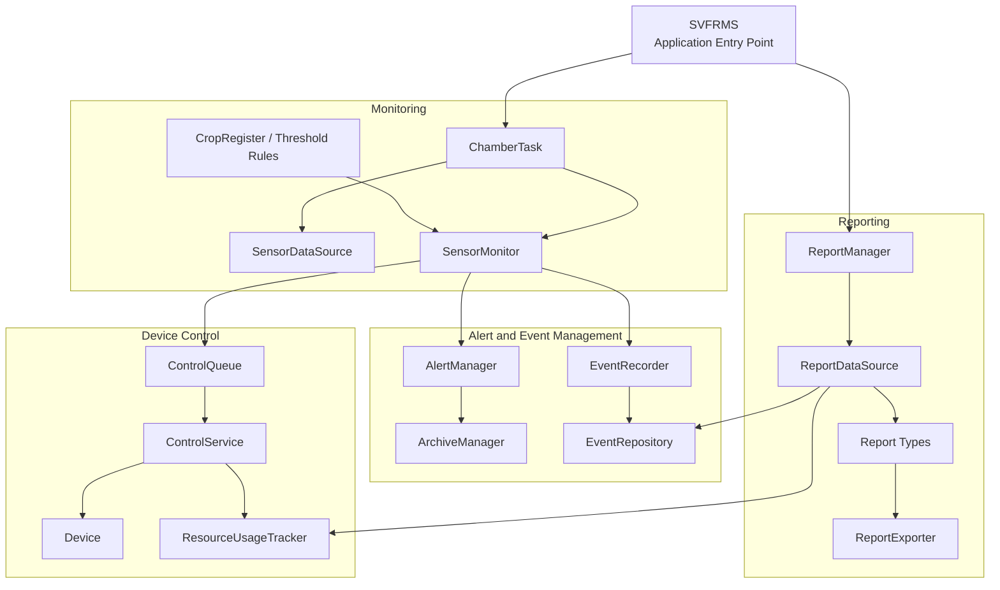
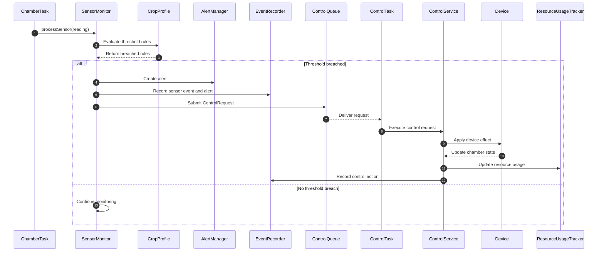
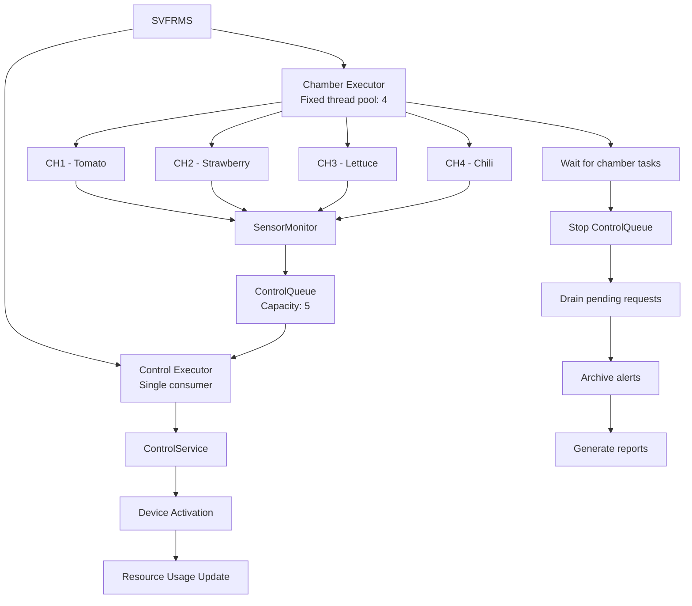

# Smart Vertical Farming Research Management System (SVFRMS)

**SE301 Group 14**

**Contributors:** Nathan, Yu-Shan, Nicholas

## 1. Project Overview

The Smart Vertical Farming Research Management System (SVFRMS) simulates the monitoring and management of an indoor vertical farm.

Each growing chamber cultivates a specific crop and continuously collects five environmental readings:

- Temperature
- Humidity
- Soil moisture
- Light intensity
- Nutrient level

When a sensor reading violates the acceptable range for its crop, the system generates an alert and queues a control action to correct the condition.

The system simulates devices such as cooling fans, water pumps, humidifiers, dehumidifiers, grow lights and nutrient injectors. It also tracks resource consumption and generates reports after the simulation completes.

This project contains two implementations:

| Implementation | Description |
|---|---|
| `legacy codebase/` | Original implementation with most responsibilities concentrated in a single class |
| `improved codebase/` | Refactored implementation with modular packages, improved concurrency management and clearer separation of responsibilities |

The improved implementation preserves the core simulation behaviour while making the system easier to maintain, extend and test.

## 2. Key Features

- **Multi-chamber simulation:** Runs four growing chambers concurrently, cultivating Tomato, Strawberry, Lettuce and Chili.
- **Sensor monitoring:** Simulates five environmental readings for each chamber.
- **Crop-specific rules:** Evaluates readings against configurable crop thresholds.
- **Alert management:** Creates, tracks, resolves and archives alerts.
- **Automated device control:** Queues and executes device actions when threshold violations occur.
- **Resource tracking:** Tracks water, energy and nutrient consumption.
- **Concurrent execution:** Uses Java ExecutorService and thread-safe data structures.
- **Report generation:** Produces environmental, crop and resource consumption reports.

## 3. System Architecture

The improved implementation separates the system into packages according to their responsibilities.

```text
org.example
├── app          Application entry point and component setup
├── alert        Alert lifecycle and archival
├── chamber      Chamber state, repository and simulation tasks
├── control      Control requests, queue and device execution
├── crop         Crop profiles and facility rules
├── event        Event recording and storage
├── logging      Application logging
├── report       Report generation and exporting
├── resource     Water, energy and nutrient tracking
└── sensor       Sensor readings, monitoring and thresholds
```

### 3.1 Component Architecture



### 3.2 Sensor Monitoring and Control Sequence

The following diagram illustrates what happens when a sensor reading breaches its configured threshold.



### 3.3 Concurrent Execution Model

The system uses four chamber tasks and a separate control consumer.



The bounded control queue separates sensor monitoring from device execution. Chamber tasks produce requests, while the control consumer processes them independently.

## 4. Design and Implementation Highlights

The improved implementation introduces several design improvements:

| Improvement | Implementation |
|---|---|
| Separation of responsibilities | Classes organised into responsibility-based packages |
| Extensible crop rules | `CropProfile`, `Threshold` and `CropRegister` |
| Dependency injection | Collaborators supplied through constructors |
| Concurrent task execution | `ExecutorService` and `Runnable` |
| Producer–Consumer | `ControlQueue` backed by `ArrayBlockingQueue` |
| Graceful shutdown | Poison Pill pattern |
| Thread-safe state management | Synchronised methods and concurrent collections |
| Report abstraction | `ReportDataSource` and `ReportExporter` |

### Design Patterns Used

- **Producer–Consumer:** Separates control request production from execution.
- **Poison Pill:** Signals the control consumer to terminate after pending requests are processed.
- **Thread Pool:** Manages chamber and control task execution.
- **Command:** Encapsulates device activation requests in `ControlRequest`.
- **Immutable Objects:** Prevents modification of shared `ControlRequest`, `Device` and `Threshold` objects.
- **Monitor Object:** Protects shared state through synchronised methods.
- **Registry:** Allows crops and devices to be registered and retrieved by name.
- **Dependency Injection:** Supplies dependencies through constructors.
- **Singleton:** Provides a shared application logger through `AppLogger`.

## 5. Prerequisites

Before running the improved implementation, ensure that the following are installed:

- **Java Development Kit (JDK):** A JDK compatible with the source code.
- **Windows:** The supplied `run.bat` script is intended for Windows.
- **PATH configuration:** The Java `java` and `javac` executables must be accessible from Command Prompt.

Verify your installation:

```bat
java -version
javac -version
```

Both commands should return a version number.

## 6. How to Run

### 6.1 Clone or Download the Project

Open a terminal in the project directory:

```bat
cd "path\to\vertical-farm"
```

### 6.2 Run the Improved Implementation

Navigate into the improved codebase:

```bat
cd "improved codebase"
```

Execute the supplied batch script:

```bat
run.bat
```

The script automatically:

1. Removes the previous `out` directory.
2. Creates a fresh output directory.
3. Recursively discovers Java source files under `src\src\main\java`.
4. Compiles the source files into `out`.
5. Starts the application using `org.example.app.SVFRMS`.

The application can also be launched manually after compilation:

```bat
java -cp out org.example.app.SVFRMS
```

### 6.3 Expected Execution

The application simulates four growing chambers, each running 20 iterations and collecting five sensor readings per iteration.

Expected total sensor readings:

```text
4 chambers × 20 iterations × 5 sensors = 400 readings
```

During execution, the system:

- Generates simulated sensor readings.
- Evaluates crop-specific thresholds.
- Creates alerts when thresholds are breached.
- Queues and executes device control requests.
- Updates resource consumption.
- Archives alerts and generates reports after the simulation finishes.

The daily report is written to:

```text
archive/daily_report.txt
```

The exact console output, alert count and resource totals may vary because sensor readings are simulated.

## 7. Project Structure

```text
vertical-farm/
│
├── README.md
├── SE301-Project-Specification.pdf
│
├── legacy codebase/
│   └── Original implementation
│
└── improved codebase/
    │
    ├── src/
    │   └── src/main/java/org/example/
    │       ├── app/
    │       ├── alert/
    │       ├── chamber/
    │       ├── control/
    │       ├── crop/
    │       ├── event/
    │       ├── logging/
    │       ├── report/
    │       ├── resource/
    │       └── sensor/
    │
    ├── archive/
    │   └── daily_report.txt
    │
    ├── out/                 Compiled class files
    ├── pom.xml              Maven project configuration
    ├── run.bat              Windows build and run script
    └── svfrms-1.0.0.jar     Packaged application JAR
```

## 8. Extending the System

The improved architecture allows new crops and devices to be introduced without modifying the core monitoring and evaluation logic.

### Adding a New Crop

Create a new `CropProfile`, register its threshold rules and add it to `CropRegister`.

Example:

```java
CropProfile kale = new CropProfile("Kale");

kale.addAbove("Temperature", 24,
    "High Temp", "Cooling Fan", 0, 10);

kale.addBelow("Soil", 50,
    "Low Soil Moisture", "Water Pump", 50, 0);

cropRegister.addCrop(kale);
```

A chamber can then be configured to grow Kale by creating a new `ChamberTask` with the corresponding crop name.

### Adding a New Device

Register a new `Device` in the control service with its sensor type, adjustment amount and permitted bounds.

Once registered, crop threshold rules can reference the new device.

## 9. Legacy vs Improved Implementation

| Area | Legacy | Improved |
|---|---|---|
| Architecture | Single large class | Responsibility-based packages |
| Sensor thresholds | Hard-coded conditional statements | Configurable threshold objects |
| Event handling | String-based dispatcher | Focused methods in `EventRecorder` |
| Device requests | Delimited strings | Immutable `ControlRequest` objects |
| Thread management | Manual thread creation and joining | `ExecutorService` |
| Shared state | Public static collections and locks | Encapsulated thread-safe components |
| Control queue | Manual `wait()` and `notifyAll()` | `ArrayBlockingQueue` |
| Extensibility | Requires modifying existing logic | Register new crops and devices |

## 10. Future Improvements

Potential areas for further development include:

- Complete dependency injection by converting remaining static dependencies into instance-based components.
- Replace string-based alert representations with typed `Alert` and `AlertStatus` objects.
- Introduce automated unit and integration tests.
- Add retry policies and failure handling for device control requests.
- Externalise crop thresholds and device configurations into configuration files.
- Introduce persistent storage for sensor readings, alerts and resource consumption.

---

**SE301 Group 14 — Smart Vertical Farming Research Management System**