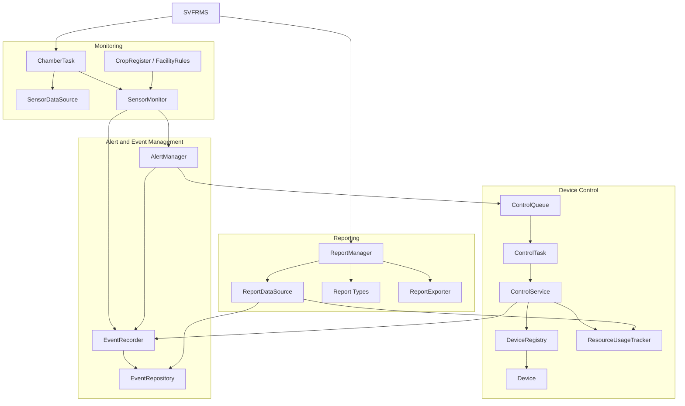
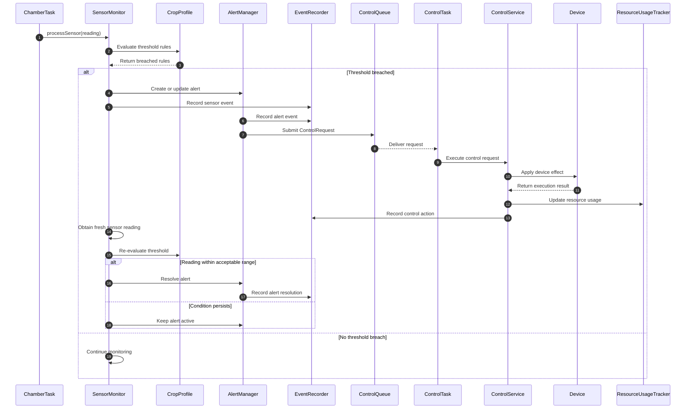

# Smart Vertical Farming Research Management System (SVFRMS)

**SE301 Group 14**

**Contributors:** Nathan, Yu-Shan, Nicholas

## 1. Project Overview

The Smart Vertical Farming Research Management System (SVFRMS) simulates the monitoring and management of an indoor vertical farm.

Each growing chamber cultivates a specific crop and continuously collects five environmental readings:

- Temperature
- Humidity
- Soil moisture
- Light intensity
- Nutrient level

When a sensor reading violates the acceptable range for its crop, the system generates an alert and queues a control action to correct the condition.

The system simulates devices such as cooling fans, water pumps, humidifiers, dehumidifiers, grow lights and nutrient injectors. It also tracks resource consumption and generates reports after the simulation completes.

This project contains two implementations:

| Implementation | Description |
|---|---|
| `legacy codebase/` | Original implementation with most responsibilities concentrated in a single class |
| `improved codebase/` | Refactored implementation with modular packages, improved concurrency management and clearer separation of responsibilities |

The improved implementation preserves the core simulation behaviour while making the system easier to maintain, extend and test.

## 2. Key Features

- **Multi-chamber simulation:** Runs four growing chambers concurrently, cultivating Tomato, Strawberry, Lettuce and Chili.
- **Sensor monitoring:** Simulates five environmental readings for each chamber.
- **Crop-specific rules:** Evaluates readings against configurable crop thresholds.
- **Alert management:** Creates, tracks, resolves and archives alerts.
- **Automated device control:** Queues and executes device actions when threshold violations occur.
- **Resource tracking:** Tracks water, energy and nutrient consumption.
- **Concurrent execution:** Uses Java ExecutorService and thread-safe data structures.
- **Report generation:** Produces environmental, crop and resource consumption reports.

## 3. System Architecture

The improved implementation separates the system into packages according to their responsibilities.

```text
org.example
├── app
│   └── SVFRMS.java
├── alert
│   ├── Alert.java
│   ├── AlertManager.java
│   ├── AlertSeverity.java
│   └── AlertStatus.java
├── chamber
│   ├── ChamberState.java
│   ├── ChamberRepository.java
│   └── ChamberTask.java
├── control
│   ├── ControlRequest.java
│   ├── ControlQueue.java
│   ├── ControlTask.java
│   ├── ControlService.java
│   ├── Device.java
│   └── DeviceRegistry.java
├── crop
│   ├── CropProfile.java
│   ├── CropRegister.java
│   └── FacilityRules.java
├── event
│   ├── EventRecorder.java
│   └── EventRepository.java
├── logging
├── report
│   ├── Report.java
│   ├── ReportManager.java
│   ├── ReportDataSource.java
│   ├── ReportExporter.java
│   └── TextReportExporter.java
├── resource
│   └── ResourceUsageTracker.java
└── sensor
    ├── SensorMonitor.java
    ├── SensorDataSource.java
    ├── SimulatedSensorDataSource.java
    └── Threshold.java
```

### 3.1 Component Architecture

The improved architecture separates sensor monitoring, alert management, event recording, device control and reporting.



### 3.2 Sensor Monitoring and Control Sequence

When a sensor reading breaches its configured threshold, the system creates an alert and submits a control request for execution.



A successful device operation does not automatically resolve an alert. The system must obtain a fresh sensor reading and confirm that the condition has returned to an acceptable range.

### 3.3 Concurrent Execution Model

The system uses a fixed thread pool for the four chamber tasks and a separate single-threaded consumer for control requests.

```
flowchart TD
    A["SVFRMS"]

    A --> B["Chamber Executor<br/>Fixed thread pool: 4"]
    A --> C["Control Executor<br/>Single consumer"]

    B --> D1["CH1 - Tomato"]
    B --> D2["CH2 - Strawberry"]
    B --> D3["CH3 - Lettuce"]
    B --> D4["CH4 - Chili"]

    D1 --> E["SensorMonitor"]
    D2 --> E
    D3 --> E
    D4 --> E

    E --> F["ControlQueue<br/>Capacity: 5"]
    F --> C
    C --> G["ControlService"]
    G --> H["Device Activation"]
    H --> I["Resource Usage Update"]

    B --> J["Wait for chamber tasks"]
    J --> K["Submit Poison Pill"]
    K --> L["Drain pending requests"]
    L --> M["Archive alerts"]
    M --> N["Generate reports"]
```

The bounded control queue separates sensor monitoring from device execution. Chamber tasks produce control requests, while the control consumer processes them independently. A poison pill signals the consumer to terminate gracefully after pending requests have been processed.

## 4. Design and Implementation Highlights

The improved implementation introduces the following design improvements:

| Improvement | Implementation |
|---|---|
| Separation of responsibilities | Classes organised into responsibility-based packages |
| Extensible crop rules | `CropProfile`, `Threshold` and `CropRegister` |
| Dependency injection | Collaborators supplied through constructors |
| Concurrent task execution | `ExecutorService` and `Runnable` |
| Producer–Consumer | `ControlQueue` backed by `ArrayBlockingQueue` |
| Graceful shutdown | Poison Pill pattern |
| Thread-safe state management | Synchronised methods and concurrent collections |
| Device registration | `DeviceRegistry` |
| Data access abstraction | `ChamberRepository` and `EventRepository` |
| Report abstraction | `Report`, `ReportDataSource` and `ReportExporter` |

### Design Patterns Used

- **Producer–Consumer:** Separates control request production from execution.
- **Poison Pill:** Signals the control consumer to terminate gracefully.
- **Thread Pool:** Manages chamber and control task execution through `ExecutorService`.
- **Command:** Encapsulates device activation requests in `ControlRequest`.
- **DTO:** Transfers control request data between components.
- **Strategy:** Allows different sensor data sources and report exporters to be used through common interfaces.
- **Repository:** Separates data access from business logic.
- **Registry:** Allows crops and devices to be registered and retrieved by name.
- **Dependency Injection:** Supplies dependencies through constructors.
- **Monitor Object:** Protects shared state through synchronised methods.

## 8. Extending the System

The improved architecture separates crop configuration and device management from the core monitoring and control logic.

### Adding a New Crop

Create a `CropProfile`, define its threshold rules and register it through `CropRegister`.

Example:

```java
CropProfile kale = new CropProfile("Kale");

kale.addUpperLimit(
    SensorType.TEMPERATURE,
    24,
    "High Temp",
    "Cooling Fan",
    0,
    10
);

kale.addLowerLimit(
    SensorType.SOIL,
    50,
    "Low Soil Moisture",
    "Water Pump",
    50,
    0
);

cropRegister.addCrop(kale);
```

A chamber can then be configured to grow Kale by creating a `ChamberTask` with the corresponding crop name.

**Note:** Default crop profiles and their thresholds are currently hardcoded in `CropRegister` to preserve the legacy implementation's behaviour. Crops can still be added or removed at runtime through its registration methods. A future implementation could externalise crop configuration or introduce a dedicated simulator to automate crop management. Light and nutrient thresholds are defined globally through `FacilityRules`, rather than separately for each crop.

### Adding a New Device

Implement the `Device` abstraction and register the device through `DeviceRegistry`. The device can then be referenced by crop threshold rules through its registered name.

### Adding a New Report Export Format

Implement the `ReportExporter` interface and supply the implementation to `ReportManager`. This allows additional formats, such as CSV or PDF, to be introduced without changing the report generation logic.

## 9. Legacy vs Improved Implementation

| Area | Legacy | Improved |
|---|---|---|
| Architecture | Single large class | Responsibility-based packages |
| Sensor thresholds | Hardcoded conditional statements | `Threshold` objects and crop profiles |
| Event handling | String-based dispatcher | Dedicated `EventRecorder` |
| Device requests | Delimited strings | `ControlRequest` objects |
| Thread management | Manual thread creation and joining | `ExecutorService` |
| Shared state | Public static collections and manual locks | Encapsulated, thread-safe components |
| Control queue | Manual `wait()` and `notifyAll()` | `ArrayBlockingQueue` |
| Device management | Embedded control logic | `DeviceRegistry` and `Device` abstraction |
| Data access | Direct collection access | Repository abstractions |
| Reporting | Tightly coupled report generation | Separate report, data source and exporter abstractions |
| Extensibility | Changes often require modifying existing logic | New crops, devices and exporters can be added through existing abstractions |


**SE301 Group 14 — Smart Vertical Farming Research Management System**